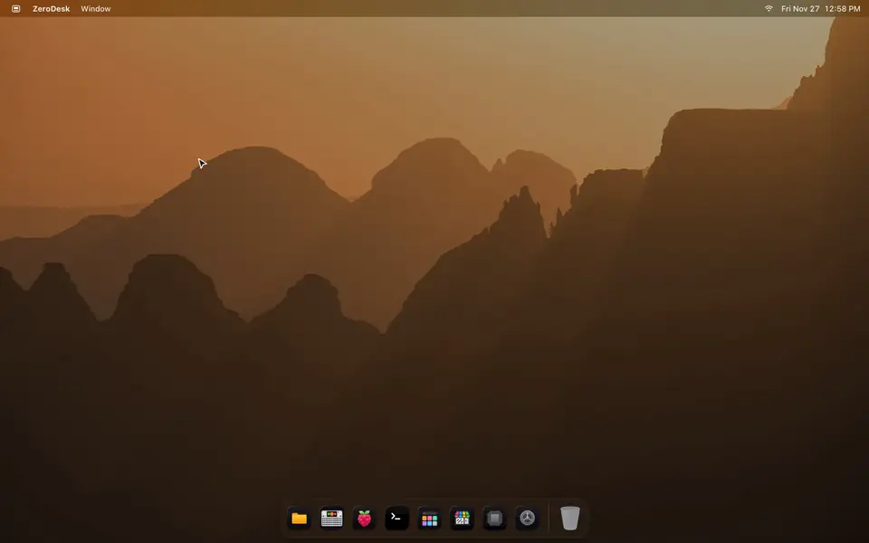

# ZeroDesk

**English** | [简体中文](README.zh-CN.md)

**A desktop and App Store for your CardputerZero, in your computer's or phone's browser.**

ZeroDesk lets you use the M5Stack CardputerZero from any computer or phone on the same network. On a computer it is a full desktop with windows and a Dock; on a phone it is a home screen of apps. Install and update apps from the built-in App Store, control the hardware (camera, compass, IR, LoRa, GPS, NFC, Sub-GHz) in native windows, manage files in Finder, run a Terminal, change settings, play music and the piano, record voice memos, and use the CardputerZero's own screen and apps with your mouse and keyboard. Nothing to install on the computer or phone.


## Contents

- [Features](#features)
  - [App Store](#app-store) · [Install apps like on a Mac](#install-apps-like-on-a-mac) · [Hardware in windows](#hardware-in-windows) · [On your phone](#on-your-phone)
- [What you need](#what-you-need)
- [Install](#install)
- [First connection](#first-connection)
- [Keyboard shortcuts](#keyboard-shortcuts)
- [Troubleshooting and FAQ](#troubleshooting-and-faq)
- [Security and privacy](#security-and-privacy)
- [Update](#update)
- [Uninstall](#uninstall)
- [For developers](#for-developers)
- [Contributing](#contributing)
- [Acknowledgements](#acknowledgements)
- [License](#license)

## Features

### App Store

Every app in the CardputerZero Store, laid out like the Mac App Store: Discover, Categories, search and Updates (with a badge when an update is waiting). Each app has its page with screenshots, permissions, size and source code link. **Get** downloads the package on the Zero, checks it against the Store's checksum and installs it together with what it depends on; the button turns into a progress ring and then into **Open**. Works on the computer and on the phone.


### Install apps like on a Mac

Drop a `.deb` from your computer anywhere on ZeroDesk, or double-click one in Finder. It opens like a disk image: the app on the left, Applications on the right. Drag the app onto Applications, enter your password, and it is installed, with its dependencies. An installed version is replaced only after you confirm.


### Hardware in windows

The CardputerZero's hardware apps run as native windows with real controls: Camera, Compass, Keyboard Guide, IR Remote, IR Chat, and the LoRa, GPS, NFC and SubG Chat caps. They talk to the same chips and use the same radio formats and files as the original apps, so a ZeroDesk window can chat with someone using the device's own app. See [docs/HARDWARE-APPS.md](docs/HARDWARE-APPS.md).


### On your phone

On a phone ZeroDesk becomes an iPhone-style home screen: pages of app icons, a widget with the Zero's battery and address, a Dock, and apps that open full screen. Add it to your home screen for a full-screen app. To sign in, scan the code on the Zero's screen with the phone's camera.


### Desktop, Dock and appearance

Windows with the familiar traffic lights, resizable from every edge and corner. The Dock works like a Mac's: Finder on the left, then the apps you keep there, then the apps that are open, then the Trash. Drag an icon to move it, drag an app in from Apps or Finder to keep it, drag it out (or right-click **Remove from Dock**) to let it go. The icons magnify under the pointer and shrink to fit a smaller screen. Light and dark appearance, or automatic by time of day, in English or Chinese.


| Light | Dark |
|---|---|
|  |  |

### Apps

Every app installed on the CardputerZero, sorted by category, with search. Type to filter, press Return to open.


| Light | Dark |
|---|---|
|  |  |

### Finder

Browse the device's files, upload by dragging files from your computer into a window, download, rename, move to the Trash, preview with Space, and install `.deb` packages with a double-click.


### Terminal

A full shell on the device, with tabs and splits, find, clickable links, inline images, copy from the shell (OSC 52), and files dropped onto the window uploaded to `~/Downloads` with their paths typed in.

Colour schemes that follow light and dark appearance, fonts (including Nerd Fonts for Powerline prompts, or any font installed on your computer) and shell add-ons such as Oh My Zsh, Powerlevel10k, Starship, fzf and zoxide are in **Settings → Terminal**. Nothing is bundled: each one is downloaded when you pick it and checked against a checksum pinned in ZeroDesk.



### Music

Plays the songs in the device's `~/Music` folder: a library with search, a player bar with shuffle and repeat, and drag-and-drop to add songs.


### Piano

An 88-key piano with real grand-piano samples. Play with the mouse (slide across the keys for a glissando) or with the keyboard; sustain pedal and octave controls in the toolbar.


### Voice Memos

Records with the CardputerZero's microphone. Scrub through the waveform, skip 15 seconds, rename and delete recordings.


### Settings

Wi-Fi, network, battery, general (restart, developer options), appearance (light and dark, wallpaper: built-in pictures with light and dark versions or your own photo, language), Terminal, display brightness and sleep, sound, expansion-port power, and date and time.


### The CardputerZero's screen

The **Cardputer** window shows the device's own screen live, and you use it like a phone: on the home screen, click an app to open it and click the arrows to page; swipe or scroll to move; right-click to go back. A click on the dark or locked screen wakes and unlocks it, and **Home** brings you back from any app, including CLI and Python. Type on your computer's keyboard as on the device's own; an on-screen copy of the device keyboard is one click away. Choose **Pixel** for an exact, sharp pixel grid or **Smooth** for an upscaled picture that fills the window.


### Linux desktop

The device's graphical Linux desktop in a window.


### Other apps

Apps you install on the CardputerZero (from its App Store or as `.deb` files) appear in **Apps**:

- Apps that come with a ZeroDesk window open as normal windows, like the built-in apps (below: Level, an example app).
- Other apps run on your computer in a window that shows their screen; use your keyboard, mouse wheel and, where the app supports it, the mouse. Choose **Open on Zero** to run them on the device instead.


## What you need

- A CardputerZero with its standard system (the image with the APPLaunch launcher, Debian 13).
- The CardputerZero and your computer on the same network (Wi-Fi or Ethernet).
- A current browser on the computer: Chrome, Edge, Safari or Firefox.

## Install

ZeroDesk comes in two editions built from the same source:

| | Store edition | GitHub edition |
|---|---|---|
| Where | CardputerZero Store | this repository's **Releases** page |
| File | `zerodesk-cp0_<version>-<rev>_arm64.deb` | `zerodesk-cp0_<version>-<rev>+full_arm64.deb` |
| All apps and features above | ✓ | ✓ |
| Installing packages, setting the clock by hand, ADB | asks for your password each time | asks for your password, or runs directly if your device allows `sudo` without one |
| Opening device apps that the launcher runs as administrator (from ZeroDesk's Apps) | open them from the device's launcher | ✓ when `sudo` works without a password |

**From the CardputerZero Store:** open **Store** on the device, search for **ZeroDesk CP0** or its share code **ZDCP**, and install.

**Upgrading from 0.2.8 or earlier:** the package used to be called `zerodesk` and is now `zerodesk-cp0` (another Store app has the name `zerodesk`). Install the new package as usual; it takes over from the old one and removes it a few seconds later, and your settings, signed-in browsers and app data stay. Reload the page if it loses the connection.

**From GitHub:**

1. Download the latest `zerodesk-cp0_<version>-<rev>+full_arm64.deb` from this repository's **Releases** page.
2. Copy it to the CardputerZero, for example with `scp`, or on a USB drive.
3. On the CardputerZero (in a terminal, or over SSH), run:

   ```bash
   sudo apt install ./zerodesk-cp0_<version>-<rev>+full_arm64.deb
   ```

ZeroDesk starts right away and every time the device starts. It needs about 6 MB of memory while nobody is connected. Its entry in the device's launcher shows whether it is running and the address to open.

## First connection

On a phone, the quickest way: open **ZeroDesk** in the device's launcher and scan the code on its screen with your phone's camera. The code works once and changes every two minutes.

1. **Open the address.** In the browser on your computer, go to **http://cardputerzero.local**. If that page does not open, use the device's IP address instead (the launcher's **IP Panel** app shows it): `http://<ip-address>`.
2. **Read the code.** The browser shows a four-digit code.

   

3. **Confirm on the device.** The CardputerZero shows the same code. Press **OK** on its keyboard within 60 seconds; any other key declines.

   

4. **Done.** The desktop opens. This browser stays connected until you log out (menu bar or Settings → General → Log Out).

Can't press a key on the device right now? Choose **Use an access token** and enter the token stored on the device in `~/.config/zerodesk/token` (for example `cat ~/.config/zerodesk/token` over SSH).


## Keyboard shortcuts

| Where | Keys | Action |
|---|---|---|
| Apps | type | Search |
| Apps | Return / Esc | Open the first result / close |
| Finder | ↑ ↓ | Select |
| Finder | Return | Rename |
| Finder | Space | Quick Look |
| Finder | ⌘⌫ or Delete | Move to Trash |
| Finder | ⌘↑ / ⌘↓ or ⌘O | Enclosing folder / open |
| Music | Space | Play / pause |
| Music | Return | Play the selected song |
| Music | ⌘← / ⌘→ | Previous / next song |
| Music | ⌘F | Search |
| Music | ⌘⌫ | Move the selected song to the Trash |
| Voice Memos | Space | Play / pause |
| Voice Memos | Return / ⌘⌫ | Rename / delete the selected recording |
| Piano | A S D F G H J K L ; ' | White keys (W E T Y U O P: black keys) |
| Piano | Z / X | Octave down / up |
| Piano | Tab | Sustain pedal |
| Cardputer and app windows | any key | Sent to the device (⌘ shortcuts stay with your computer) |
| Cardputer and app windows | scroll | Arrow keys, both directions |
| Menus, sheets | Esc | Close |

## Troubleshooting and FAQ

**`cardputerzero.local` does not open.** Make sure the computer and the CardputerZero are on the same network, then use the IP address instead. Some networks and VPNs block device names; the IP address always works. Turn off a VPN on the computer if the IP address does not work either.

**I pressed OK but nothing happened.** The request lasts 60 seconds. Click **Connect again**, then press OK while the code is on the device's screen.

**The Cardputer window is blurry or too small.** Choose **Pixel** in the window's toolbar for a sharp pixel grid, or **Smooth** to fill the window; make the window larger for a larger picture.

**Typing in the Cardputer window does nothing.** Click the screen first; a ring around it shows that it receives your keys.

**The Linux desktop window keeps showing "Starting".** The device needs its graphical desktop running (the standard image starts it automatically). It can take several seconds on a slow network.

**Piano sounds like a simple synthesizer at first.** The first time, the device downloads the piano samples (about 6 MB); until then a built-in synthesizer plays.

**An app runs on the device instead of in a window.** Some apps need hardware access only the device can give; choose them in Apps and pick **Open on Zero**.

**ZeroDesk asks for a password.** Installing packages, setting the clock by hand and turning ADB on or off need administrator rights. Enter the device user's password (the one you use with `sudo`); it is used for that one action and not stored.

**Does ZeroDesk change how the device works on its own?** No. The launcher and its apps keep working as before.

## Security and privacy

- **What is on the network:** ZeroDesk answers HTTP on ports 80 and 8686 of the CardputerZero. Every page and command except the login screen needs a signed-in browser.
- **How signing in works:** a browser gets in only after someone presses OK on the device itself, scans the one-time code shown on the device's screen, or enters the device's access token. The browser then keeps a session cookie that scripts cannot read and that is never sent to other sites. Log out to remove it.
- **Encryption:** the connection is plain HTTP, like most devices on a home network. Use ZeroDesk on networks you trust.
- **Privileges:** ZeroDesk runs as the device's normal user, never as root. Actions that need administrator rights ask for your password each time (GitHub edition: unless the device allows `sudo` without one); the password is used once and not stored.
- **Apps with their own windows** run in an isolated frame: they cannot read your session or call ZeroDesk's functions except through the permissions they declare.
- **Your data stays on the device.** ZeroDesk sends nothing about you anywhere. Outside requests: the App Store reads the official CardputerZero Store catalogue, icons, screenshots and packages from GitHub or the Store's China mirror (chosen with a country lookup at ipinfo.io, as the device's own Store does), and checks every package against the Store's checksum; the first use of Piano downloads the piano samples from a public sample library.

## Update

Open **App Store → Updates** in ZeroDesk, or the Store on the device: both update ZeroDesk like any other app. For the GitHub edition, download the newer `.deb` and install it the same way. Your settings, connected browsers and app data are kept.

## Uninstall

```bash
sudo apt remove zerodesk-cp0
```

To also remove the access token and app data: `rm -rf ~/.config/zerodesk ~/.local/share/zerodesk`.

## For developers

**Give your CardputerZero app a ZeroDesk window.** People who open ZeroDesk on a computer or phone then get your app as a real window, with mouse, keyboard, light and dark appearance and phone layout, instead of a 320×170 picture of the device screen. A web page, a `manifest.webmanifest` and the ZeroDesk SDK are all it takes; hardware apps add a small backend that runs as the device's user. Ship the window inside your normal CardputerZero `.deb` (its files under `/usr/share/<your-package>/`, one `X-ZeroDesk-Web=` line in your launcher entry) and ZeroDesk picks it up; on devices without ZeroDesk nothing changes.

- [docs/APP-SPEC.md](docs/APP-SPEC.md): give a CardputerZero app its own ZeroDesk window (manifest, sandbox, JavaScript SDK), with the example in [examples/level](examples/level).
- [docs/DEVELOPMENT.md](docs/DEVELOPMENT.md): architecture, building, packaging and deploying ZeroDesk.
- [docs/HARDWARE-APPS.md](docs/HARDWARE-APPS.md): the native windows for Compass, Camera, Keyboard Guide, IR, LoRa, GPS, NFC and SubG Chat, and how they share hardware and files with the original apps.

## Contributing

Contributions are welcome, from a typo fix to a new window for someone's app. Small fixes can go straight to a pull request; for bigger changes, open an issue first so we can agree on the approach before you put time into it.

**Report a bug or suggest something.** Open an [issue](https://github.com/richardhxwang/ZeroDesk/issues) and say what you did, what you expected and what happened instead, with the ZeroDesk version (`dpkg-query -W zerodesk-cp0` on the device) and your browser. A screenshot or short recording helps a lot. Leave out your access token, the sign-in QR code and your network addresses.

**Send a pull request.**

1. Fork the repository and create a branch from `main`.
2. Run the UI from your computer against your own device: `cd ui && pnpm install && ZERODESK_DEVICE=http://<device-host>:8686 pnpm dev`. To install your build on the device, run `./deploy.sh pi@<device-host>`. [docs/DEVELOPMENT.md](docs/DEVELOPMENT.md) explains the layout, the build and the UI rules.
3. Before you send it, run `pnpm check` in `ui/` and `go test ./...` in `agent/`, and look at your change in light and dark, in a wide window and at phone width.
4. Keep one change per pull request, and describe what it changes and how you tried it on a device.

Issues, pull requests and commit messages can be in any language you're comfortable with; English and Chinese are both fine.

**Other ways to help.** Translate ZeroDesk into your language (the strings are in [ui/src/state/i18n.svelte.ts](ui/src/state/i18n.svelte.ts)), give your own CardputerZero app a ZeroDesk window (see [For developers](#for-developers)), or try ZeroDesk on a device and tell us what felt wrong.

## Acknowledgements

Inspired by [macOS Web](https://github.com/PuruVJ/macos-web) by PuruVJ. ZeroDesk builds on [Svelte](https://svelte.dev), [neodrag](https://github.com/PuruVJ/neodrag), [wavesurfer.js](https://wavesurfer.xyz), [smplr](https://github.com/danigb/smplr) with the public-domain Splendid Grand Piano samples, [Framework7 Icons](https://framework7.io/icons/), [xterm.js](https://xtermjs.org), [noVNC](https://novnc.com), [WebSR](https://github.com/sb2702/websr), [popmotion](https://popmotion.io), [coder/websocket](https://github.com/coder/websocket), [creack/pty](https://github.com/creack/pty) and Go's x/image and x/text, and is packaged with [nfpm](https://nfpm.goreleaser.com). Their licences and copyright notices are in [THIRD_PARTY_NOTICES.md](THIRD_PARTY_NOTICES.md).

## License

ZeroDesk is released under the MIT License; see [LICENSE](LICENSE).
