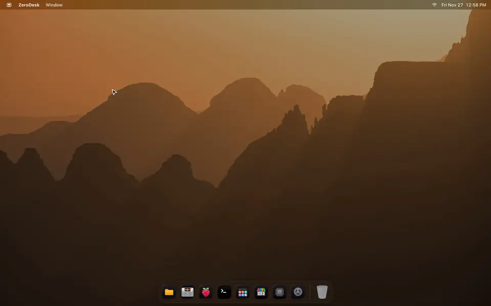

# ZeroDesk

[English](README.md) | **简体中文**

**在电脑或手机的浏览器里，给 CardputerZero 用上桌面和 App Store。**

同一网络里的电脑或手机，打开浏览器就能用 ZeroDesk 操作 M5Stack CardputerZero。在电脑上，它是一整套带窗口和程序坞的桌面；在手机上，它是一屏屏的 App 图标。你可以在内置的 App Store 里安装和更新 App，在原生窗口里操作硬件（摄像头、指南针、红外、LoRa、GPS、NFC、Sub-GHz），用访达管理文件，打开终端，修改设置，听音乐、弹钢琴、录语音备忘录，还能用鼠标和键盘直接操作 CardputerZero 自己的屏幕和 App。电脑和手机上都不用安装任何东西。


## 目录

- [功能](#功能)
  - [App Store](#app-store) · [像在 Mac 上一样安装 App](#像在-mac-上一样安装-app) · [窗口里的硬件](#窗口里的硬件) · [在手机上使用](#在手机上使用)
- [准备](#准备)
- [安装](#安装)
- [第一次连接](#第一次连接)
- [键盘快捷键](#键盘快捷键)
- [常见问题](#常见问题)
- [安全与隐私](#安全与隐私)
- [更新](#更新)
- [卸载](#卸载)
- [开发者](#开发者)
- [参与贡献](#参与贡献)
- [致谢](#致谢)
- [许可证](#许可证)

## 功能

### App Store

CardputerZero 商店里的全部 App，按 Mac App Store 的样子排列：发现、类别、搜索和更新（有更新时会显示角标）。每个 App 都有自己的页面，展示截图、所需权限、大小和源代码链接。点 **获取**，Zero 会下载安装包，用商店提供的校验值核对，然后连同依赖一起装好；按钮会先变成进度环，再变成 **打开**。电脑和手机上都能用。


### 像在 Mac 上一样安装 App

把电脑上的 `.deb` 拖到 ZeroDesk 的任意位置，或者在访达里双击它，它会像磁盘映像一样打开：左边是 App，右边是“应用程序”。把 App 拖到“应用程序”上，输入密码，就连同依赖一起装好了。如果已经装有这个 App，只有在你确认后才会替换。


### 窗口里的硬件

CardputerZero 的硬件 App 以原生窗口运行，带有真正的控件：摄像头、指南针、键盘指南、红外遥控、红外聊天，以及 LoRa、GPS、NFC 和 SubG Chat 扩展模块。它们直接和同一颗芯片通信，使用和原版 App 相同的无线格式和文件，所以 ZeroDesk 的窗口可以和使用设备自带 App 的人互相聊天。详见 [docs/HARDWARE-APPS.md](docs/HARDWARE-APPS.md)。


### 在手机上使用

在手机上，ZeroDesk 是一个 iPhone 风格的主屏幕：一页页的 App 图标，一个显示 Zero 电量和地址的小组件，底部的程序坞，打开 App 时全屏显示。添加到主屏幕后，它就像一个全屏 App。登录时用手机相机扫一下 Zero 屏幕上的二维码即可。


### 桌面、程序坞和外观

窗口带有熟悉的红黄绿三个按钮，四边和四角都能拖动调整大小。程序坞的用法和 Mac 一样：最左边是访达，接着是固定在程序坞里的 App，然后是正在打开的 App，最右边是废纸篓。拖动图标可以调整位置；从“应用”或访达里拖一个 App 进来就会固定在程序坞里；把它拖出去（或右键选 **从程序坞中移除**）就会移除。鼠标经过时图标会放大，屏幕变小时图标也会跟着缩小。支持浅色、深色外观，也可以按时间自动切换，界面语言有中文和英文。


| 浅色 | 深色 |
|---|---|
|  |  |

### 应用

CardputerZero 上安装的所有 App，按类别排列，可以搜索。直接打字就能筛选，按回车键打开。


| 浅色 | 深色 |
|---|---|
|  |  |

### 访达

浏览设备上的文件。把电脑上的文件拖进窗口就能上传，也可以下载、重命名、移到废纸篓，按空格键预览，双击 `.deb` 安装包即可安装。


### 终端

设备上的完整 shell，支持标签页和分屏、查找、可点击的链接、内嵌图片、从 shell 复制（OSC 52）。把文件拖到窗口上，会上传到 `~/Downloads` 并自动填入路径。

**设置 → 终端** 里可以选配色（随浅色、深色外观切换）、字体（包括显示 Powerline 提示符所需的 Nerd 字体，也可以用你电脑上装的任何字体），以及 Oh My Zsh、Powerlevel10k、Starship、fzf、zoxide 等 shell 扩展。这些都不随 ZeroDesk 打包：选中时才下载，并用 ZeroDesk 里固定的校验和核对。



### 音乐

播放设备 `~/Music` 文件夹里的歌曲：带搜索的资料库、带随机播放和重复播放的播放栏，拖进来就能添加歌曲。


### 钢琴

88 键钢琴，用的是真实三角钢琴的采样。可以用鼠标弹（在琴键上滑过就是刮奏），也可以用键盘弹；延音踏板和八度切换在工具栏里。


### 语音备忘录

用 CardputerZero 的麦克风录音。可以在波形上拖动定位、前后跳 15 秒、重命名和删除录音。


### 设置

Wi-Fi、网络、电池、通用（重新启动、开发者选项）、外观（浅色和深色、墙纸、语言）、终端、屏幕亮度和休眠、声音、扩展接口供电，以及日期与时间。


### CardputerZero 的屏幕

**Cardputer** 窗口实时显示设备自己的屏幕，用起来和手机一样：在主屏幕上点一个 App 就能打开，点两侧的箭头翻页；滑动或滚动来移动；右键返回。屏幕黑着或锁着时点一下，就会点亮并解锁；不管在哪个 App 里（包括 CLI 和 Python），点 **主屏幕** 都能回到主屏幕。用电脑键盘打字，效果和设备自带的键盘一样；点一下就能调出设备键盘的屏幕版。选 **像素显示** 可以得到清晰、精确的像素格，选 **平滑显示** 则会放大画面铺满窗口。


### Linux 桌面

在窗口里显示设备的图形化 Linux 桌面。


### 其他 App

在 CardputerZero 上安装的 App（从它的商店，或者用 `.deb` 文件）都会出现在 **应用** 里：

- 自带 ZeroDesk 窗口的 App，会和内置 App 一样以普通窗口打开（下图中的 Level 是一个示例 App）。
- 其他 App 在电脑上以窗口形式运行，窗口里显示它的画面；可以用键盘、鼠标滚轮操作，App 支持的话也能用鼠标。如果想让它在设备上运行，选 **在 Zero 上打开**。


## 准备

- 一台装有标准系统的 CardputerZero（带 APPLaunch 启动器的 Debian 13 镜像）。
- CardputerZero 和电脑连在同一个网络里（Wi-Fi 或有线网络）。
- 电脑上有一个较新的浏览器：Chrome、Edge、Safari 或 Firefox。

## 安装

ZeroDesk 有两个版本，用同一份源代码构建：

| | 商店版 | GitHub 版 |
|---|---|---|
| 获取方式 | CardputerZero 商店 | 本仓库的 **Releases** 页面 |
| 文件 | `zerodesk-cp0_<version>-<rev>_arm64.deb` | `zerodesk-cp0_<version>-<rev>+full_arm64.deb` |
| 上面介绍的所有 App 和功能 | ✓ | ✓ |
| 安装软件包、手动设置时间、ADB | 每次都要输入密码 | 要输入密码；如果设备允许免密码 `sudo`，则直接执行 |
| 打开启动器以管理员身份运行的设备 App（在 ZeroDesk 的“应用”里） | 请从设备的启动器打开 | `sudo` 免密码时可以打开 |

**从 CardputerZero 商店安装：** 在设备上打开 **Store**，搜索 **ZeroDesk for CP0** 或分享码 **ZDCP**，然后安装。

**从 0.2.8 及更早版本升级：** 安装包原来叫 `zerodesk`，现在改名为 `zerodesk-cp0`（商店里另有一个 App 用了 `zerodesk` 这个名字）。照常安装新包即可，它会接替旧版，并在几秒后自动卸掉旧包；你的设置、已登录的浏览器和 App 数据都会保留。如果页面断开连接，刷新一下就好。

**从 GitHub 安装：**

1. 在本仓库的 **Releases** 页面下载最新的 `zerodesk-cp0_<version>-<rev>+full_arm64.deb`。
2. 把它复制到 CardputerZero 上，比如用 `scp`，或者用 U 盘。
3. 在 CardputerZero 上（终端里或通过 SSH）运行：

   ```bash
   sudo apt install ./zerodesk-cp0_<version>-<rev>+full_arm64.deb
   ```

ZeroDesk 装好后立即启动，以后设备每次开机也会自动启动。没有人连接时，它大约占用 6 MB 内存。设备启动器里的 ZeroDesk 入口会显示它是否在运行，以及要打开的地址。

## 第一次连接

在手机上最快的方法：在设备的启动器里打开 **ZeroDesk**，用手机相机扫屏幕上的二维码。这个二维码只能用一次，每两分钟会换一个。

1. **打开地址。** 在电脑的浏览器里访问 **http://cardputerzero.local**。如果打不开，就改用设备的 IP 地址（启动器里的 **IP Panel** App 会显示）：`http://<ip-address>`。
2. **看验证码。** 浏览器会显示一个四位数验证码。

   

3. **在设备上确认。** CardputerZero 会显示同样的验证码。60 秒内在它的键盘上按 **OK**；按其他任何键都会拒绝。

   

4. **完成。** 桌面打开了。这个浏览器会一直保持登录，直到你退出登录（在菜单栏，或 设置 → 通用 → 退出登录）。

暂时没法在设备上按键？选 **改用访问口令**，输入设备上 `~/.config/zerodesk/token` 里保存的口令（比如通过 SSH 运行 `cat ~/.config/zerodesk/token`）。


## 键盘快捷键

| 位置 | 按键 | 作用 |
|---|---|---|
| 应用 | 直接打字 | 搜索 |
| 应用 | 回车 / Esc | 打开第一个结果 / 关闭 |
| 访达 | ↑ ↓ | 选择 |
| 访达 | 回车 | 重命名 |
| 访达 | 空格 | 快速查看 |
| 访达 | ⌘⌫ 或 Delete | 移到废纸篓 |
| 访达 | ⌘↑ / ⌘↓ 或 ⌘O | 上一级文件夹 / 打开 |
| 音乐 | 空格 | 播放 / 暂停 |
| 音乐 | 回车 | 播放选中的歌曲 |
| 音乐 | ⌘← / ⌘→ | 上一首 / 下一首 |
| 音乐 | ⌘F | 搜索 |
| 音乐 | ⌘⌫ | 把选中的歌曲移到废纸篓 |
| 语音备忘录 | 空格 | 播放 / 暂停 |
| 语音备忘录 | 回车 / ⌘⌫ | 重命名 / 删除选中的录音 |
| 钢琴 | A S D F G H J K L ; ' | 白键（W E T Y U O P 是黑键） |
| 钢琴 | Z / X | 降低 / 升高一个八度 |
| 钢琴 | Tab | 延音踏板 |
| Cardputer 和 App 窗口 | 任意键 | 发送到设备（⌘ 组合键仍由电脑处理） |
| Cardputer 和 App 窗口 | 滚动 | 方向键，上下左右都可以 |
| 菜单、弹出面板 | Esc | 关闭 |

## 常见问题

**打不开 `cardputerzero.local`。** 先确认电脑和 CardputerZero 在同一个网络里，然后改用 IP 地址。有些网络和 VPN 会屏蔽设备名，IP 地址总是能用的。如果 IP 地址也打不开，请关掉电脑上的 VPN 再试。

**按了 OK 却没反应。** 确认请求只在 60 秒内有效。点 **重新连接**，趁设备屏幕上还显示验证码时再按 OK。

**Cardputer 窗口模糊或太小。** 在窗口工具栏里选 **像素显示** 可以得到清晰的像素格，选 **平滑显示** 可以铺满窗口；把窗口拉大，画面也会跟着变大。

**在 Cardputer 窗口里打字没反应。** 先点一下屏幕，屏幕周围出现一圈边框，就表示它在接收你的按键了。

**Linux 桌面窗口一直显示“正在启动”。** 设备需要运行图形桌面（标准镜像会自动启动）。网络慢的时候可能要等几秒。

**钢琴一开始听起来像简单的合成器。** 第一次使用时，设备会下载钢琴采样（约 6 MB），下载完之前用的是内置合成器。

**有的 App 在设备上运行，没有出现在窗口里。** 有些 App 需要只有设备本身才能提供的硬件权限；在“应用”里选中它，再选 **在 Zero 上打开**。

**ZeroDesk 要我输入密码。** 安装软件包、手动设置时间、打开或关闭 ADB 都需要管理员权限。输入设备用户的密码（就是你用 `sudo` 时输入的那个）；密码只用于这一次操作，不会保存。

**ZeroDesk 会改变设备本身的用法吗？** 不会。启动器和它的 App 照常使用。

## 安全与隐私

- **网络上开放了什么：** ZeroDesk 在 CardputerZero 的 80 和 8686 端口提供 HTTP 服务。除了登录页面，所有页面和命令都需要已登录的浏览器。
- **怎么登录：** 只有在有人在设备上按了 OK、扫了设备屏幕上的一次性二维码，或者输入了设备的访问口令之后，浏览器才能进入。之后浏览器会保存一个会话 Cookie，网页脚本读不到它，也不会发给其他网站。退出登录就会删除它。
- **加密：** 连接使用普通 HTTP，和大多数家庭网络里的设备一样。请在你信任的网络里使用 ZeroDesk。
- **权限：** ZeroDesk 以设备的普通用户身份运行，从不使用 root。需要管理员权限的操作每次都会要求输入密码（GitHub 版在设备允许免密码 `sudo` 时除外）；密码只用一次，不会保存。
- **带有自己窗口的 App** 运行在隔离的框架里：除了它们声明过的权限，它们读不到你的会话，也调用不了 ZeroDesk 的功能。
- **你的数据留在设备上。** ZeroDesk 不会把任何关于你的信息发到别处。对外的请求只有这些：App Store 从 GitHub 或商店的中国镜像读取官方 CardputerZero 商店的目录、图标、截图和安装包（和设备自带的商店一样，通过 ipinfo.io 查询所在国家来选择），并用商店的校验值核对每一个安装包；第一次使用钢琴时，会从一个公开的采样库下载钢琴采样。

## 更新

在 ZeroDesk 里打开 **App Store → 更新**，或者在设备上打开商店：两种方式都能像更新其他 App 一样更新 ZeroDesk。GitHub 版请下载新版 `.deb`，按同样的方法安装。你的设置、已登录的浏览器和 App 数据都会保留。

## 卸载

```bash
sudo apt remove zerodesk-cp0
```

如果还想删除访问口令和 App 数据：`rm -rf ~/.config/zerodesk ~/.local/share/zerodesk`。

## 开发者

**给你的 CardputerZero App 做一个 ZeroDesk 窗口。** 这样，在电脑或手机上打开 ZeroDesk 的人看到的就是一个真正的窗口，支持鼠标、键盘、浅色和深色外观以及手机布局，比一张 320×170 的设备屏幕画面好用得多。只需要一个网页、一个 `manifest.webmanifest` 和 ZeroDesk SDK；硬件类 App 再加一个以设备用户身份运行的小后端即可。把窗口放进你平常的 CardputerZero `.deb` 里（文件放在 `/usr/share/<your-package>/` 下，在启动器入口里加一行 `X-ZeroDesk-Web=`），ZeroDesk 就会自动识别；没装 ZeroDesk 的设备上一切照旧。

- [docs/APP-SPEC.md](docs/APP-SPEC.md)：怎样给 CardputerZero App 做一个 ZeroDesk 窗口（manifest、沙盒、JavaScript SDK），示例见 [examples/level](examples/level)。
- [docs/DEVELOPMENT.md](docs/DEVELOPMENT.md)：ZeroDesk 的架构、构建、打包和部署。
- [docs/HARDWARE-APPS.md](docs/HARDWARE-APPS.md)：指南针、摄像头、键盘指南、红外、LoRa、GPS、NFC 和 SubG Chat 的原生窗口，以及它们怎样和原版 App 共用硬件和文件。

## 参与贡献

欢迎参与贡献，修一个错别字也好，给某个 App 做一个新窗口也好。小的修改可以直接提 pull request；改动比较大的话，请先开一个 issue，商量好做法再动手，免得白费功夫。

**报告问题或提建议。** 开一个 [issue](https://github.com/richardhxwang/ZeroDesk/issues)，写清楚你做了什么、期望的结果和实际发生了什么，附上 ZeroDesk 的版本（在设备上运行 `dpkg-query -W zerodesk-cp0`）和你用的浏览器。有截图或一小段录屏会很有帮助。请不要贴出你的访问口令、登录二维码和网络地址。

**提交 pull request。**

1. Fork 本仓库，从 `main` 新建一个分支。
2. 在电脑上运行界面，连接你自己的设备：`cd ui && pnpm install && ZERODESK_DEVICE=http://<device-host>:8686 pnpm dev`。要把你的构建装到设备上，运行 `./deploy.sh pi@<device-host>`。[docs/DEVELOPMENT.md](docs/DEVELOPMENT.md) 介绍了代码结构、构建方法和界面规范。
3. 提交前，在 `ui/` 里运行 `pnpm check`，在 `agent/` 里运行 `go test ./...`，并在浅色和深色外观、宽窗口和手机宽度下都看一看你的改动。
4. 一个 pull request 只做一件事，说明改了什么、在设备上是怎么测试的。

issue、pull request 和提交信息用你习惯的语言写就行，中文、英文都可以。

**其他参与方式。** 把 ZeroDesk 翻译成你的语言（文案在 [ui/src/state/i18n.svelte.ts](ui/src/state/i18n.svelte.ts) 里），给你自己的 CardputerZero App 做一个 ZeroDesk 窗口（见 [开发者](#开发者)），或者在设备上试用 ZeroDesk，告诉我们哪里用着不顺手。

## 致谢

ZeroDesk 的灵感来自 PuruVJ 的 [macOS Web](https://github.com/PuruVJ/macos-web)。ZeroDesk 用到了 [Svelte](https://svelte.dev)、[neodrag](https://github.com/PuruVJ/neodrag)、[wavesurfer.js](https://wavesurfer.xyz)、[smplr](https://github.com/danigb/smplr)（以及属于公有领域的 Splendid Grand Piano 采样）、[Framework7 Icons](https://framework7.io/icons/)、[xterm.js](https://xtermjs.org)、[noVNC](https://novnc.com)、[WebSR](https://github.com/sb2702/websr)、[popmotion](https://popmotion.io)、[coder/websocket](https://github.com/coder/websocket)、[creack/pty](https://github.com/creack/pty)，以及 Go 的 x/image 和 x/text，并用 [nfpm](https://nfpm.goreleaser.com) 打包。它们的许可证和版权声明见 [THIRD_PARTY_NOTICES.md](THIRD_PARTY_NOTICES.md)。

## 许可证

ZeroDesk 以 MIT 许可证发布，详见 [LICENSE](LICENSE)。
